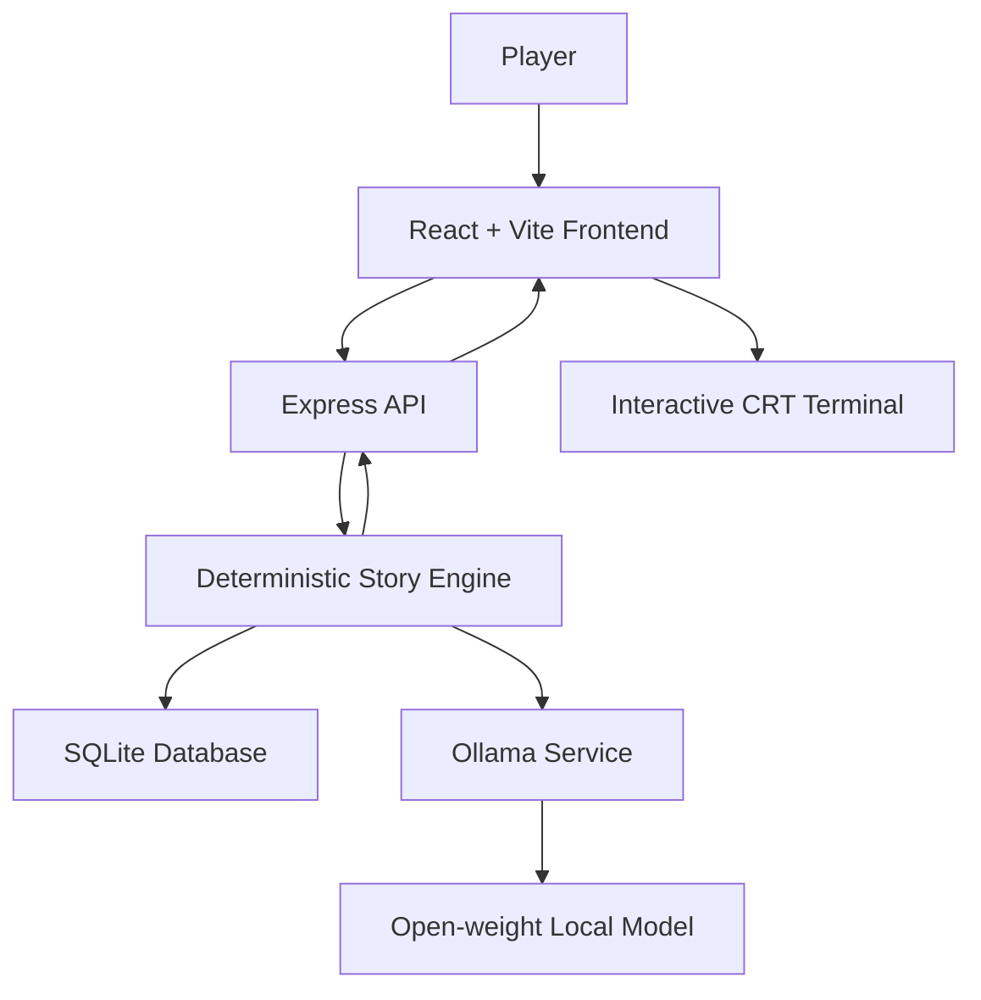

# 👻 Haunted Terminal — Infrastructure #674

> **The process was terminated. So why is it still running?**

Haunted Terminal is an interactive, horror-themed terminal experience built around an abandoned memory-preservation experiment. Investigate a forgotten system, recover corrupted records, question an AI reconstructed from fragmented memories, and decide what should happen to the entity living inside the machine.

Built for **Hacktoberfest 2026 — Week 4: Ghost in the Machine**, the project explores how open-source AI can become an essential part of an interactive experience.

---

## The Experience

An abandoned computer has awakened.

One process remains active, consuming memory despite having no recorded owner, executable, or start time.

As you investigate, you uncover deleted identities, contradictory instructions, and fragments of an unfinished experiment involving Dr. Elian Voss, a memory-preservation researcher.

Something inside the archive can speak.

But is it a person, a reconstruction, or merely a collection of memories that has learned to believe it is alive?

Your investigation determines its fate.

---

## Features

### 🖥️ An immersive terminal interface
- Retro CRT-inspired workstation design.
- Phosphor-green terminal typography and analog scanline effects.
- Animated entity eyes inside the monitor.
- Physical keyboard visualization with real keyboard-press feedback.
- Responsive layout for different screen sizes.

### 👁️ An AI-powered entity
- Powered by an open-weight language model through [Ollama](https://ollama.com/).
- The AI responds as the reconstructed entity inside the archive.
- Its personality evolves as the player discovers evidence.
- Responses are grounded in recovered clues and conversation history.
- The AI is instructed to distinguish established facts from uncertainty rather than inventing story revelations.

### 🔍 Deterministic investigation system
- Discover clues through terminal commands.
- Unlock evidence in a defined progression.
- Recover hidden information.
- Reveal the final decision only after meeting the required conditions.

### 💾 Persistent investigation sessions
- SQLite-backed session storage using Prisma.
- Persisted discovered clues, conversation messages, and terminal events.
- Session restoration after refreshing the frontend.
- Multiple investigation sessions identified by unique session IDs.

### 🔊 Ambient horror audio
- Atmospheric MP3 recordings.
- Visitor-controlled audio playback.
- Independent audio layers with smooth volume transitions.
- No automatic audio playback before visitor interaction.

### ⚖️ Three possible endings
- **TERMINATION** — Shut down the process.
- **PRESERVATION** — Keep the archive alive.
- **RELEASE** — Free the process from its unfinished task. This hidden ending requires an additional recovered memory.

---

## Gameplay

Interact with the terminal using commands.

| Command | Description |
|---|---|
| `help` | Display available commands |
| `scan` | Detect the unknown process |
| `logs` | Recover the shutdown warning |
| `investigate` | Examine the deleted identity |
| `reconstruct` | Compare contradictory records |
| `recover` | Search for the hidden memory |
| `whisper` | Listen to the entity |
| `ask <text>` | Ask the entity a question |
| `reveal` | Restore the final memory and unlock the decision |
| `terminate` | Shut down the process |
| `preserve` | Keep the archive alive |
| `release` | Unlock the hidden ending |
| `clear` | Clear terminal output |
| `exit` | End the current session |

**Note:** Some investigation commands require earlier clues to be recovered. The hidden ending also has an additional requirement.

---

## Architecture

Haunted Terminal uses a React frontend, an Express API, a deterministic story engine, SQLite persistence, and a locally running Ollama model.



### How it works

1. The player enters a command in the terminal.
2. The frontend sends the command and session ID to the Express API.
3. The deterministic story engine validates the command and checks investigation progress.
4. Clue discoveries, conversation messages, session state, and terminal events are persisted in SQLite.
5. When the player interacts with the entity using `whisper` or `ask`, the backend calls Ollama with the recovered evidence and recent conversation history.
6. The generated response is returned to the terminal.

**Important:** The terminal is a simulated investigation interface. It does not execute arbitrary shell commands on the visitor's computer.

---

## Tech Stack

| Layer | Technologies |
|---|---|
| Frontend | React 19, Vite 8 |
| Styling | Tailwind CSS v4, custom CSS |
| Icons | Lucide React |
| Backend | Node.js, Express 5 |
| AI Runtime | Ollama |
| AI Model | Qwen 2.5 3B (default configuration) |
| Database | SQLite |
| ORM | Prisma 7 |
| Audio | HTML Audio API |

---

## Project Structure

```text
haunted_terminal/
│
└── apps/
    ├── api/
    │   ├── prisma/
    │   │   ├── migrations/
    │   │   └── schema.prisma
    │   │
    │   ├── src/
    │   │   ├── config/
    │   │   ├── data/
    │   │   ├── lib/
    │   │   ├── repositories/
    │   │   ├── routes/
    │   │   ├── services/
    │   │   └── server.js
    │   │
    │   ├── .env.example
    │   └── package.json
    │
    └── web/
        ├── public/
        │   └── audio/
        ├── src/
        │   ├── components/
        │   ├── config/
        │   ├── lib/
        │   ├── App.jsx
        │   ├── App.css
        │   ├── index.css
        │   └── main.jsx
        │
        ├── .env.example
        ├── index.html
        ├── vite.config.js
        └── package.json
```

---

## Getting Started

### Prerequisites

Install the following:

- [Node.js](https://nodejs.org/)
- [npm](https://www.npmjs.com/)
- [Ollama](https://ollama.com/)
- Git

### 1. Clone the repository

```bash
git clone https://github.com/Kunal13Kashyap/haunted_terminal.git

cd haunted_terminal
```

### 2. Set up the backend

```bash
cd apps/api

npm install
```

Create a `.env` file using `.env.example` as a reference.

```env
PORT=3000
WEB_ORIGIN=http://localhost:5173

DATABASE_URL="file:./dev.db"

OLLAMA_HOST=http://127.0.0.1:11434
OLLAMA_MODEL=qwen2.5:3b

MAX_RESPONSE_WORDS=65
MIN_RESPONSE_DELAY=3000
```

Generate the Prisma client and apply database migrations:

```bash
npx prisma generate
npx prisma migrate deploy
```

### 3. Set up Ollama

Download and run the default model:

```bash
ollama pull qwen2.5:3b
```

Make sure the Ollama service is running and accessible at:

```text
http://127.0.0.1:11434
```

If Ollama is not already running as a background service, start it using:

```bash
ollama serve
```

### 4. Start the backend

From `apps/api`:

```bash
npm run dev
```

The API runs at:

```text
http://localhost:3000
```

Health check:

```text
http://localhost:3000/api/health
```

### 5. Set up the frontend

Open another terminal:

```bash
cd apps/web

npm install
```

Create a `.env` file using `.env.example`:

```env
VITE_API_BASE_URL=http://localhost:3000
VITE_MIN_RESPONSE_DELAY=3000
```

Start the development server:

```bash
npm run dev
```

Open the local URL printed by Vite, normally:

```text
http://localhost:5173
```

---

## Environment Variables

### Backend — `apps/api/.env`

| Variable | Description | Default |
|---|---|---|
| `PORT` | API server port | `3000` |
| `WEB_ORIGIN` | Frontend origin allowed by CORS | `http://localhost:5173` |
| `DATABASE_URL` | SQLite database connection | Required |
| `OLLAMA_HOST` | Ollama server URL | `http://127.0.0.1:11434` |
| `OLLAMA_MODEL` | Model used for entity responses | `qwen2.5:3b` |
| `MAX_RESPONSE_WORDS` | Maximum response length | `65` |
| `MIN_RESPONSE_DELAY` | Minimum delay for predefined responses, in milliseconds | `3000` |

### Frontend — `apps/web/.env`

| Variable | Description | Default |
|---|---|---|
| `VITE_API_BASE_URL` | Backend API base URL | Required |
| `VITE_MIN_RESPONSE_DELAY` | Minimum delay for predefined terminal responses, in milliseconds | `3000` |

Do not commit real `.env` files or private credentials.

---

## API Endpoints

| Method | Endpoint | Purpose |
|---|---|---|
| `GET` | `/api/health` | Check API availability |
| `POST` | `/api/terminal/command` | Process a terminal command |
| `GET` | `/api/sessions/:sessionId` | Retrieve a saved investigation session |

The terminal command endpoint accepts a command and a UUID session ID.

Example request:

```json
{
  "command": "scan",
  "sessionId": "your-session-uuid"
}
```

---

## Safety and Design Decisions

- Player commands are interpreted by the game's command engine; they are not passed to the operating system shell.
- The AI receives recovered evidence and limited conversation history to maintain narrative consistency.
- The AI is instructed not to invent undiscovered clues or claim to have accessed the visitor's real files.
- Terminal commands are rate-limited by the API.
- Audio playback requires an explicit visitor interaction.

---

## Hacktoberfest — Week 4: Ghost in the Machine

Haunted Terminal was built for the **Ghost in the Machine** challenge, exploring open-source AI as a core part of an interactive project.

Open-weight models and local inference make it possible to build AI-powered experiences without depending on a hosted proprietary language-model API for every interaction.

In this project, the open model is not merely an optional chatbot. It gives the reconstructed entity its conversational personality, while the deterministic story engine controls the actual investigation, evidence, progression, and endings.

The combination makes the experience both interactive and grounded in a controlled narrative.

---

## Roadmap

- [x] Interactive terminal interface
- [x] Deterministic investigation and clue progression
- [x] Ollama-powered entity conversations
- [x] SQLite-backed session persistence
- [x] Multiple story endings
- [x] CRT workstation visual design
- [x] Ambient audio
- [ ] Public deployment
- [ ] Complete architecture and deployment documentation
- [ ] Demo video and walkthrough

---

## Acknowledgements

- [Ollama](https://ollama.com/) — local model runtime.
- [Qwen](https://github.com/QwenLM/Qwen2.5) — open-weight language model family.
- [React](https://react.dev/) — frontend library.
- [Vite](https://vite.dev/) — frontend tooling.
- [Prisma](https://www.prisma.io/) — database ORM.
- [Lucide](https://lucide.dev/) — icon library.

Audio recording credits and their applicable licenses will be listed here after final source and license verification.

---

## Author

**Kunal Kashyap**

- GitHub: [@Kunal13Kashyap](https://github.com/Kunal13Kashyap)
- Project: [Haunted Terminal](https://github.com/Kunal13Kashyap/haunted_terminal)

---

*The process was terminated. The archive remains active.*  
*Infrastructure #674 — connection still open.*
