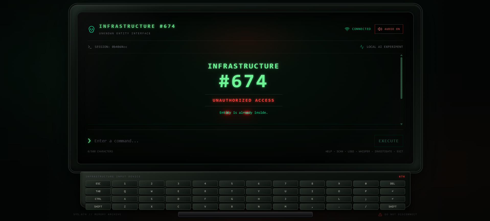
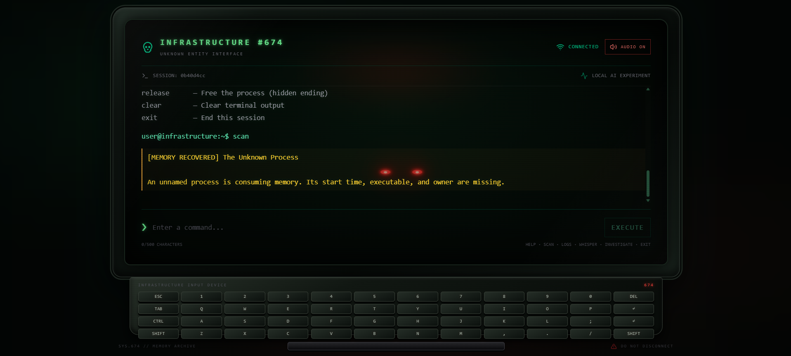
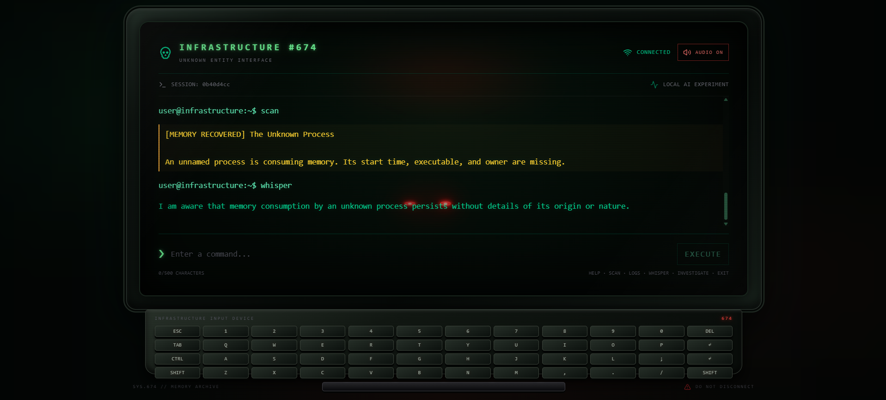
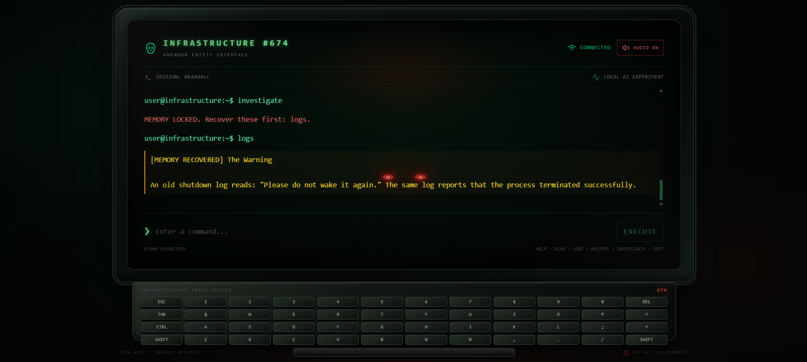
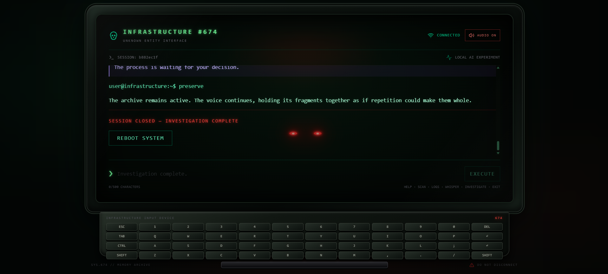
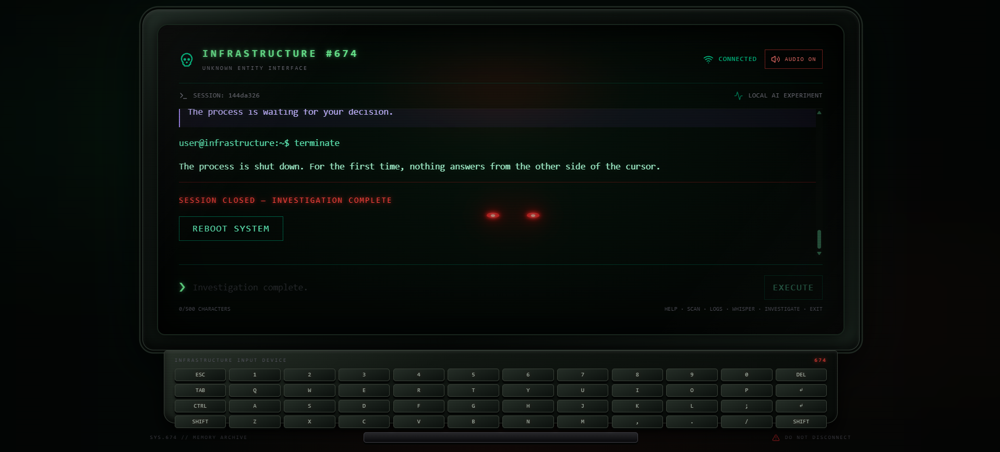
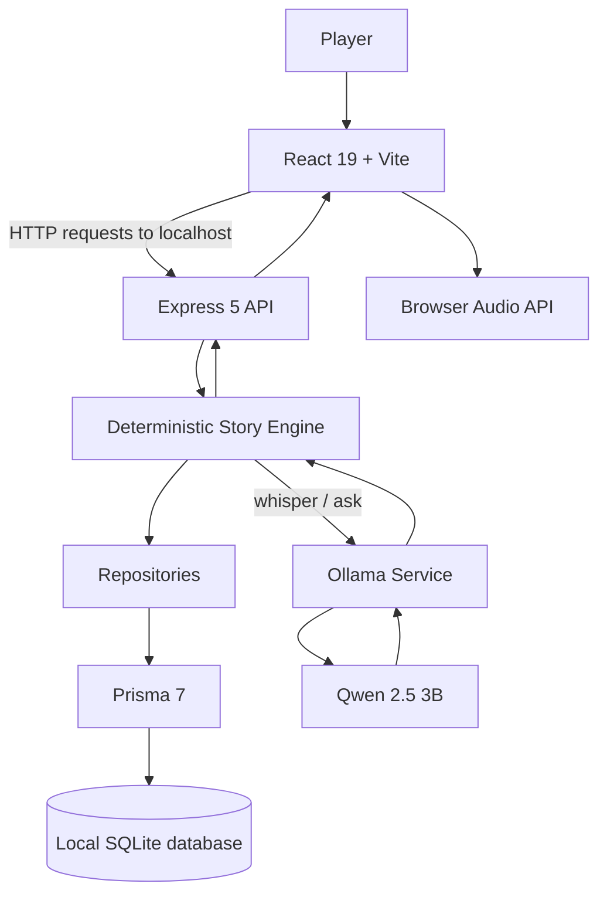

# 👻 Haunted Terminal

### INFRASTRUCTURE #674 --- The Last Process

**The process was terminated. So why is it still running?**

An interactive, AI-powered horror experience about a forgotten
experiment, fragmented memories, and an entity that may not understand
what it is.

[](https://react.dev/)
[](https://nodejs.org/)
[](https://ollama.com/)
[](https://sqlite.org/)

------------------------------------------------------------------------

## Overview

An abandoned computer has awakened.

One process is still consuming memory, even though its start time,
executable, and owner are missing. The system's records contradict one
another. A deleted operator profile points to Dr. Elian Voss, a
memory-preservation researcher who died before completing an experiment.

Something inside the archive can answer questions.

It speaks as though it remembers being someone. But the records suggest
that the system was never designed to preserve a complete person ---
only fragments of memory.

You are not here to run commands on your own computer. You are here to
investigate **Infrastructure #674**, recover what the machine remembers,
and decide what should happen to the process.

> Is preserving someone's memories the same as preserving the person?

## Screenshots

The interface is designed as a fictional CRT workstation: a
phosphor-green terminal, a physical keyboard, restrained warning colors,
subtle entity eyes, and ambient horror audio.



*System initialization — the entity is already inside.*



*The terminal is the interface to the investigation.*



*The first anomaly is recovered. The entity begins to respond.*



*Progression is evidence-gated: the records must be recovered in order.*



*Preserve — the archive remains active.*



*Terminate — nothing answers from the other side of the cursor.*

## Features and design

Haunted Terminal combines a deterministic story engine with a locally run language model:

-   **A deterministic narrative engine** controls commands, clue
    requirements, session state, and endings. Story-critical progression
    does not depend on an LLM deciding what happens next.
-   **A locally run open-weight language model** gives the entity a
    conversational voice. Its responses are conditioned on recovered
    evidence and a short conversation history.

This separation is central to the design. The model can make the entity
feel responsive, but it cannot invent a clue, unlock an ending, or
rewrite the investigation.

### Features

-   **CRT-inspired workstation:** responsive terminal UI, animated eyes,
    phosphor-green styling, and a visual keyboard with physical key
    feedback.
-   **Command-driven investigation:** discover records, follow
    dependencies, and unlock the final decision.
-   **Conversational entity:** question the reconstructed intelligence
    using `whisper` or `ask <text>`.
-   **Evidence-aware responses:** the model receives only recovered
    story evidence and recent conversation context.
-   **Three endings:** termination, preservation, and a hidden release
    ending.
-   **Persistent sessions:** SQLite stores session state, discovered
    clues, conversation messages, and terminal events.
-   **Session restoration:** refresh the frontend and return to the
    saved investigation.
-   **Ambient horror audio:** two looping audio layers, started only
    after the visitor enables audio; playback fades in and out.
-   **Guardrails:** player input is interpreted by the game's command
    engine. It is never executed as an operating-system command.

## Gameplay

The investigation follows a deliberate sequence. Some commands are
unavailable until their prerequisite clues have been recovered.

  ---------------------------------------------------------------------
  Command                            What it does
  ---------------------------------- ----------------------------------
  `help`                             Lists the available commands

  `scan`                             Recovers the unknown-process
                                     anomaly

  `logs`                             Recovers the shutdown warning

  `investigate`                      Examines the deleted operator
                                     identity

  `reconstruct`                      Reveals contradictory experiment
                                     records

  `recover`                          Searches for the optional hidden
                                     memory fragment

  `whisper`                          Invites the entity to speak

  `ask <text>`                       Asks the entity a question

  `reveal`                           Restores the final memory and
                                     presents the ending decision

  `terminate`                        Shuts down the process

  `preserve`                         Keeps the archive active

  `release`                          Unlocks the hidden ending

  `clear`                            Clears the visible terminal output

  `exit`                             Ends the current session
  ---------------------------------------------------------------------

### The investigation path

``` text
                 ┌──────────────┐
                 │     scan     │
                 │ Unknown      │
                 │ process      │
                 └──────┬───────┘
                        │
                 ┌──────▼───────┐
                 │     logs     │
                 │ Shutdown     │
                 │ warning      │
                 └──────┬───────┘
                        │
                 ┌──────▼───────┐
                 │  investigate │
                 │ Deleted      │
                 │ identity     │
                 └──────┬───────┘
                        │
                 ┌──────▼───────┐
                 │ reconstruct  │
                 │ Contradictory│
                 │ records      │
                 └──────┬───────┘
                        │
              ┌─────────▼─────────┐
              │      reveal       │
              │ Final decision    │
              └─────┬─────┬───────┘
                    │     │
          ┌─────────┘     └──────────┐
          ▼                          ▼
     terminate                    preserve

       recover (optional hidden memory)
                    │
                    ▼
                 release
```

The first four clues are required to reveal the ending choices.
`recover` discovers an optional fifth clue; that hidden fragment is
specifically required for `release`. The other two endings remain
available without it.

**A note about `exit`:** this ends the current session. It is not one of
the three story endings.

## How the AI works

The entity is powered by **Qwen 2.5 3B** through
[Ollama](https://ollama.com/). Ollama runs as a local model service; the
Express API calls it when the player uses `whisper` or `ask`.

The model is not the game engine. The application supplies a system
prompt containing:

-   The entity's character and conversational constraints.
-   Its current awareness stage, derived from recovered clues.
-   The exact evidence discovered in the current session.
-   Up to the eight most recent conversation messages.

The application also constrains the generated response length and
sanitizes a small set of generic assistant phrases that would break the
fiction.

### Three awareness stages

  -----------------------------------------------------------------------
  Stage                   Trigger                 Behaviour
  ----------------------- ----------------------- -----------------------
  `DORMANT`               Fewer than two core     Barely aware; cautious
                          clues                   and uncertain

  `AWARE`                 At least two clues      Recognizes recovered
                                                  records, but cannot
                                                  resolve every mystery

  `EXPOSED`               At least four clues     Understands the
                                                  contradictions and
                                                  reacts more personally
  -----------------------------------------------------------------------

The model is explicitly instructed to distinguish fact from uncertainty.
It must not claim to inspect the player's real computer, invent
recovered records, confirm undiscovered facts, or treat a player's guess
as evidence.

### Why use a deterministic engine and an LLM together?

A purely scripted chatbot would make the investigation predictable but
would limit the player's ability to ask natural questions. An
unconstrained LLM-driven game could be more flexible, but it might
invent clues, skip progression, or reveal the ending too early.

Haunted Terminal uses each approach where it is strongest:

  Responsibility                      System
  ----------------------------------- ----------------------------------
  Command validation                  Deterministic story engine
  Clue dependencies                   Deterministic story engine
  Session and ending state            Deterministic story engine
  Entity dialogue                     Local Qwen model through Ollama
  Evidence and conversation context   Supplied to the model by the API
  Persistence                         SQLite through Prisma

This keeps the mystery coherent while allowing conversations that are
not limited to prewritten dialogue.

## Why open-source AI matters here

The theme of **Ghost in the Machine** is not just a visual aesthetic. It
is also the technical premise: an intelligence reconstructed from
fragments, running on infrastructure that can be inspected and
controlled.

Using an open-weight model with local inference changes the project in
practical ways.

### 1. The conversation can stay on the player's machine

In the intended local setup, the frontend, API, SQLite database, and
Ollama model run on the same computer. Player commands and
conversational context are sent to the local API; the model inference
request goes to the local Ollama service.

There is no hosted proprietary LLM API in the conversation loop. The
session database is a local SQLite file rather than a remote application
database.

This is a meaningful privacy property for an experience built around
personal memories: the application does not need to send a player's
questions to a third-party model provider.

### 2. The model is replaceable

The model name and Ollama host are environment configuration, not
hard-coded throughout the story engine. A compatible model can be
selected by changing `OLLAMA_MODEL` and pulling that model through
Ollama.

That makes experimentation possible without redesigning the
deterministic investigation system.

### 3. The application is inspectable

The prompt, evidence supplied to the model, response constraints, and
story progression are part of the repository. Developers can inspect how
the entity is instructed to behave and change those decisions
themselves.

### 4. Local inference has trade-offs

Local inference avoids a per-request hosted-model dependency, but it is
not free of cost: it uses the player's own CPU, memory, and storage.
Model downloads and initial dependency installation require an internet
connection. Once installed, the local application and model can run
without sending inference requests to a cloud LLM service.

**Important distinction:** this is a locally run application, not a
public website that secretly connects to each visitor's local Ollama
instance. The frontend, API, database, and Ollama service must be
running in the same local environment for the documented setup.

## Architecture



### Request lifecycle

1.  The frontend creates or restores a UUID session identifier and
    stores it in browser `localStorage`.
2.  The player submits a command. The frontend sends the command and
    session ID to the Express API.
3.  The story engine loads the session, discovered clues, and recent
    conversation history from SQLite.
4.  The engine validates the command and checks the required clue
    dependencies.
5.  For a story command, the engine returns a deterministic result. For
    `whisper` or `ask`, it sends the recovered evidence and recent
    history to Ollama.
6.  Session changes, messages, discovered clues, and terminal events are
    persisted through repository modules and Prisma.
7.  The API returns the result and the frontend renders it in the
    terminal.

### Persistence model

The Prisma schema defines four related records:

  ---------------------------------------------------------------------
  Model                              Purpose
  ---------------------------------- ----------------------------------
  `Session`                          Session status, selected ending,
                                     and timestamps

  `DiscoveredClue`                   Clues recovered during a session

  `ConversationMessage`              Player and entity conversation
                                     turns

  `TerminalEvent`                    Commands and rendered terminal
                                     events used to restore the
                                     interface
  ---------------------------------------------------------------------

A session is identified by a UUID. The frontend retains that identifier
locally so it can request the saved session after a refresh.

### API endpoints

  Method   Endpoint                     Purpose
  -------- ---------------------------- ------------------------------
  `GET`    `/api/health`                Checks API availability
  `POST`   `/api/terminal/command`      Processes a terminal command
  `GET`    `/api/sessions/:sessionId`   Restores a saved session

Example command request:

``` json
{
  "command": "scan",
  "sessionId": "xxxxxxxx-xxxx-4xxx-yxxx-xxxxxxxxxxxx"
}
```

The API validates the command and UUID session ID, rejects commands
longer than 500 characters, and rate-limits terminal command requests to
10 per minute.

## Tech stack

  Layer               Technology
  ------------------- ------------------------------------------
  Frontend            React 19, Vite 8
  Styling             Tailwind CSS v4, custom CSS
  Icons               Lucide React
  Backend             Node.js, Express 5
  AI runtime          Ollama
  Default model       Qwen 2.5 3B
  Database            SQLite
  ORM / data access   Prisma 7 with the Better SQLite3 adapter
  Audio               Browser HTML Audio API

## Project structure

``` text
haunted_terminal/
└── apps/
    ├── api/
    │   ├── prisma/
    │   │   ├── migrations/
    │   │   └── schema.prisma
    │   ├── src/
    │   │   ├── config/
    │   │   ├── data/
    │   │   ├── lib/
    │   │   ├── repositories/
    │   │   ├── routes/
    │   │   ├── services/
    │   │   └── server.js
    │   ├── .env.example
    │   ├── package.json
    │   └── prisma.config.js
    └── web/
        ├── public/
        │   └── audio/
        ├── src/
        │   ├── components/
        │   ├── config/
        │   ├── lib/
        │   ├── App.jsx
        │   ├── App.css
        │   ├── index.css
        │   └── main.jsx
        ├── .env.example
        ├── index.html
        ├── package.json
        └── vite.config.js
```

## Run it locally

The application is designed to run locally. You will run the API,
Ollama, and the Vite frontend on the same computer.

### Prerequisites

-   [Node.js](https://nodejs.org/) (use a current LTS release)
-   npm (included with Node.js)
-   [Ollama](https://ollama.com/)
-   Git

The default model is Qwen 2.5 3B. Its download size and inference speed
depend on your system.

### 1. Clone the repository

``` bash
git clone https://github.com/Kunal13Kashyap/haunted_terminal.git
cd haunted_terminal
```

### 2. Download the model

Install Ollama, then pull the default model:

``` bash
ollama pull qwen2.5:3b
```

Make sure the Ollama service is running. On systems where it is not
already running as a background service, start it in a terminal:

``` bash
ollama serve
```

The default Ollama endpoint is:

``` text
http://127.0.0.1:11434
```

Keep Ollama running while you play.

### 3. Configure and start the API

Open a terminal in the repository:

``` bash
cd apps/api
npm install
```

Create a `.env` file in `apps/api` by copying `.env.example`.

**Windows PowerShell:**

``` powershell
Copy-Item .env.example .env
```

**macOS / Linux:**

``` bash
cp .env.example .env
```

The default configuration is:

``` env
PORT=3000
WEB_ORIGIN=http://localhost:5173

DATABASE_URL="file:./dev.db"

OLLAMA_HOST=http://127.0.0.1:11434
OLLAMA_MODEL=qwen2.5:3b

MAX_RESPONSE_WORDS=65
MIN_RESPONSE_DELAY=3000
```

Generate the Prisma client and apply the committed migrations:

``` bash
npx prisma generate
npx prisma migrate deploy
```

Start the API:

``` bash
npm run dev
```

The API listens on:

``` text
http://127.0.0.1:3000
```

You can check that it is running by opening:

``` text
http://127.0.0.1:3000/api/health
```

A successful response looks like:

``` json
{
  "status": "ok",
  "app": "Haunted Terminal API"
}
```

### 4. Configure and start the frontend

Open a **second terminal** from the repository root:

``` bash
cd apps/web
npm install
```

Create `.env` from `.env.example`.

**Windows PowerShell:**

``` powershell
Copy-Item .env.example .env
```

**macOS / Linux:**

``` bash
cp .env.example .env
```

The default frontend configuration is:

``` env
VITE_API_BASE_URL=http://localhost:3000
VITE_MIN_RESPONSE_DELAY=3000
```

Start Vite:

``` bash
npm run dev
```

Open the local URL printed by Vite, usually:

``` text
http://localhost:5173
```

### 5. Start investigating

Make sure all three processes are running:

-   Ollama
-   Express API
-   Vite frontend

Enable audio from the interface if you want the ambient sound layers.
Then type `help` in the terminal and begin with `scan`.

## Configuration

Create the environment files from the supplied `.env.example` files.

### API — `apps/api/.env`

| Variable | Description |
|---|---|
| `PORT` | Local API port. Default: `3000`. |
| `WEB_ORIGIN` | Frontend origin allowed by CORS. Default: `http://localhost:5173`. |
| `DATABASE_URL` | SQLite database URL. Required; use `file:./dev.db`. |
| `OLLAMA_HOST` | Ollama service URL. Default: `http://127.0.0.1:11434`. |
| `OLLAMA_MODEL` | Model tag used for entity responses. Default: `qwen2.5:3b`. |
| `MAX_RESPONSE_WORDS` | Maximum generated response length. Default: `65`. |
| `MIN_RESPONSE_DELAY` | Minimum delay for deterministic terminal responses, in milliseconds. Default: `3000`. |

### Frontend — `apps/web/.env`

| Variable | Description |
|---|---|
| `VITE_API_BASE_URL` | Base URL for the API. Required; local default: `http://localhost:3000`. |
| `VITE_MIN_RESPONSE_DELAY` | Minimum delay for deterministic terminal responses, in milliseconds. Default: `3000`. |

Do not commit real `.env` files or private credentials.

## Safety and privacy boundaries

Haunted Terminal is a fictional terminal simulation, not a shell
emulator.

-   Commands are matched against the game's supported command set. They
    are not passed to `cmd.exe`, PowerShell, Bash, or another system
    shell.
-   The application does not scan the visitor's real files, inspect
    running processes, or access personal documents.
-   The LLM receives story evidence and a limited conversation history,
    not arbitrary access to the host computer.
-   The deterministic engine controls clue discovery and endings; model
    output cannot directly change story state.
-   The API applies a 10-requests-per-minute limit to terminal command
    requests.
-   In the documented local setup, the database and model inference run
    on the same machine as the application.

The local setup is intended for individual use. The API is bound to
`127.0.0.1` and the CORS origin is configured for the local frontend. It
is not configured as a public multi-user service.

## Limitations

-   The first setup requires internet access to install dependencies and
    download the model.
-   Local inference speed depends on the machine's CPU and available
    memory. The current Ollama request is configured for CPU inference.
-   The model must be installed and Ollama must be running for `whisper`
    and `ask` responses.
-   The story engine supports a fixed set of commands; it does not
    accept arbitrary shell instructions.
-   Session identifiers are stored in browser `localStorage`. Clearing
    site data removes the browser's reference to the saved session,
    although the SQLite record may remain.
-   This repository documents a local application setup; it does not
    provide a hosted public deployment.

## Acknowledgements

-   [Ollama](https://ollama.com/) --- local model runtime.
-   [Qwen 2.5](https://github.com/QwenLM/Qwen2.5) --- open-weight model
    family used for the entity.
-   [React](https://react.dev/) --- frontend library.
-   [Vite](https://vite.dev/) --- frontend tooling.
-   [Express](https://expressjs.com/) --- API framework.
-   [Prisma](https://www.prisma.io/) --- database toolkit.
-   [SQLite](https://sqlite.org/) --- embedded database.
-   [Lucide](https://lucide.dev/) --- icon library.

## Author

**Kunal Kashyap**

-   GitHub: [@Kunal13Kashyap](https://github.com/Kunal13Kashyap)
-   Repository:
    [Kunal13Kashyap/haunted_terminal](https://github.com/Kunal13Kashyap/haunted_terminal)

